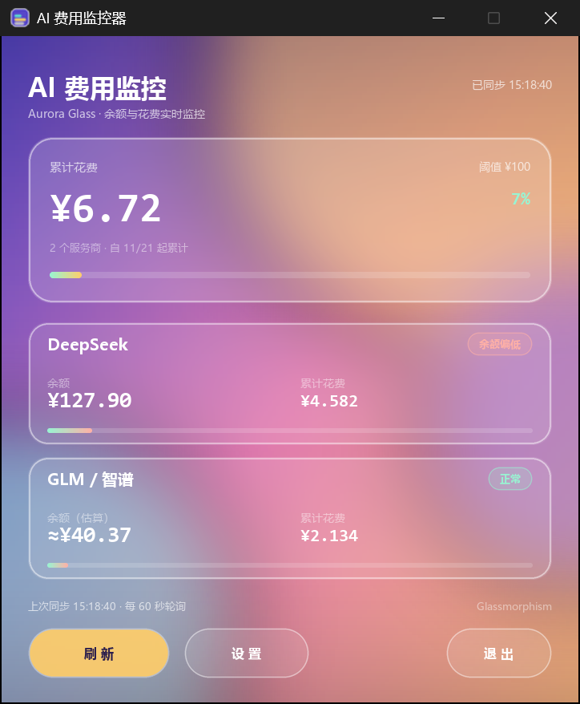
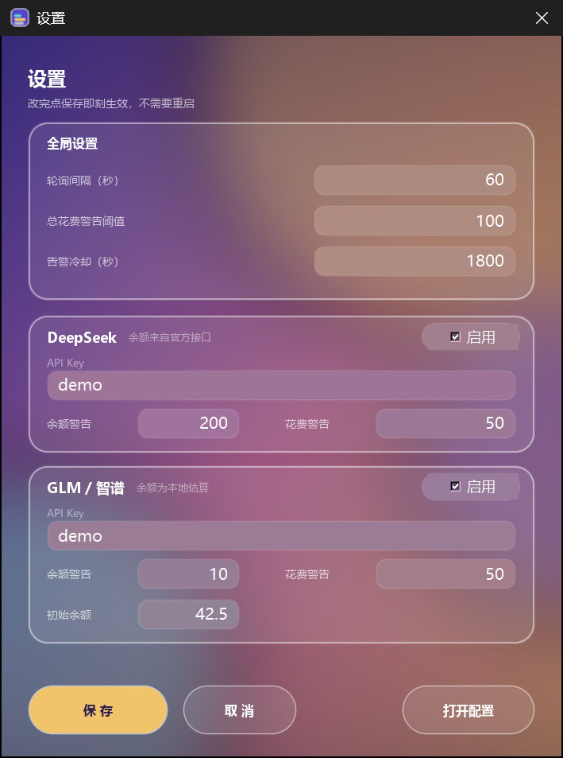

# AI 费用监控器 · Aurora Glass

DeepSeek / 智谱（GLM）余额与花费的桌面监控面板。视觉走 **玻璃拟态（Glassmorphism）**：
对角渐变背景 + 高斯模糊光斑 + 磨砂玻璃卡片 + 1px 高光描边。



<p align="center">
  
  
</p>

## 功能

- **实时余额**：DeepSeek 走官方 `/user/balance`；智谱没有公开余额接口，用「初始余额 − 累计花费」本地估算并明确标注 `≈`。
- **累计花费**：按百万 token 单价实时计价，考虑缓存命中价与 DeepSeek 错峰折扣，落盘到 `%APPDATA%\AIMonitor\state.json`，重启不归零。
- **告警**：余额不足 / 单服务商花费超限 / 总花费超限。冷却期内只提醒一次，条件恢复后自动重新武装。
- **托盘**：关闭按钮 = 收进托盘（双击恢复，右键菜单可刷新/退出）。托盘不可用时关闭就是真退出，不留幽灵进程。
- **设置改完即生效**：轮询间隔、阈值、API Key、启用状态都会重建服务商与轮询器，不需要重启。
- **可观测**：所有异常写 `monitor.log`；查询失败会在对应卡片上显示原因，而不是只留一个 `----`。

## 快速开始

```powershell
pip install -r requirements.txt

# 1) 复制一份自己的配置（config.json 已被 .gitignore 忽略，避免 API Key 进版本库）
copy config.example.json config.json
#    然后编辑 config.json（或用界面里的「设置」）：
#    把 deepseek.enabled 设为 true、api_key 填上

python main.py          # 打开面板
python main.py --once   # 查一次余额并打印，适合排障
python main.py --demo   # 用假数据预览界面（不读配置、不写状态）
```

命令 | 作用
--- | ---
`python main.py` | 打开玻璃面板
`python main.py --once` | 同步查询一次并打印快照
`python main.py --demo` | 假数据预览（调样式/截图用）
`python main.py --config D:\path\config.json` | 指定配置文件

## 配置

```jsonc
{
  "currency": "CNY",            // 影响符号与金额格式
  "polling_interval": 60,       // 秒，最小 5
  "total_spend_alert": 100,     // 总花费阈值
  "alert_cooldown": 1800,       // 同一告警的冷却秒数
  "pricing": {
    "off_peak_window": ["00:30", "08:30"],  // DeepSeek 错峰时段（北京时间）
    "off_peak_multiplier": 0.5              // 错峰倍率
  },
  "providers": {
    "deepseek": { "enabled": true, "api_key": "sk-...", "balance_alert": 10, "spend_alert": 50 },
    "zhipu":    { "enabled": true, "api_key": "...", "initial_balance": 100,
                  "balance_alert": 10, "spend_alert": 50 }
  }
}
```

保存设置时用的是**深度合并**：你在 `config.json` 里手写的额外字段（例如自定义的 `models`）不会被界面覆盖掉。

价格表在 `monitor/prices.py`，单位是「元 / 百万 token」，文件头记录了更新时间和来源。价目变动时改这里即可；模型名支持最长前缀匹配，`deepseek-v4-flash-20260101` 这类带日期后缀的也能算对。

## 接入记账

监控器本身不代理请求，花费靠调用方上报（OpenAI 风格 usage 直接可用）：

```python
from monitor.pricing import Monitor
from monitor.providers.base import Usage

monitor = Monitor()            # 读取 config.json
monitor.start()

# 方式一：直接给 token 数
monitor.record_usage("deepseek", "deepseek-v4-flash", Usage(
    prompt_tokens=12800, completion_tokens=900, cache_hit_tokens=9200))

# 方式二：把接口返回的 usage 字典塞进来
monitor.record_from_usage_dict("zhipu", "glm-5.3-flash", response["usage"])
```

花费会立刻累计、落盘，并触发阈值检查。价目表里没有的模型按 0 元记账，同时写一条 warning，并在面板底部提示「N 个模型缺价目」——不会悄悄少算。

## 结构

```
main.py                 入口（GUI / --once / --demo）
monitor/
  app.py                主窗口：布局、交互、玻璃告警浮条
  settings_ui.py        设置对话框（玻璃凹槽 + 真实 Entry）
  render.py             Pillow 画布：渐变、模糊光斑、玻璃面板、圆角/文字
  theme.py              设计令牌（取自 06-glassmorphism 的配色）
  pricing.py            业务核心：服务商、记账、告警、热重载
  balance.py            后台轮询线程（可打断、异步刷新）
  alerter.py            告警规则（冷却 + 重新武装，纯逻辑）
  state.py              花费持久化
  config.py             配置默认值 / 校验 / 深度合并 / 原子写
  prices.py             价目表与匹配
  peak_hours.py         错峰时段
  tray.py               托盘图标（pywin32 + Pillow）
  providers/            deepseek.py / zhipu.py / base.py
tests/test_core.py      20 个回归测试
```

设计取舍：tkinter 没有背景模糊，所以背景与玻璃面板是**烘焙进 Pillow 图**再铺到 Canvas 上的
（面板会真的模糊自己背后的那片背景）；文字、按钮、进度条每帧重绘，交互区用逻辑矩形做命中。
`theme.py` 只放令牌，`render.py` 不知道任何业务，方便以后换风格。

## 开发

```powershell
python -m unittest discover -s tests -v   # 20 个测试
python main.py --demo                     # 只看界面
```

日志：`%APPDATA%\AIMonitor\monitor.log`（滚动 3 份，每份 512KB）。
运行态数据：`%APPDATA%\AIMonitor\{state.json,tray.ico}`。
用 `AI_MONITOR_HOME` / `AI_MONITOR_CONFIG` 环境变量可以改这两个位置。

### 已知限制

- 智谱的余额是估算：没有官方接口，重启后依旧准的前提是 `initial_balance` 填对。
- 花费依赖调用方上报，本工具不拦截 API 请求。
- 错峰时段/倍率按官方口径配置化，官方调价请同步 `config.json` 与 `prices.py`。
- 高清屏已做 DPI 感知（2x 渲染），但 4K 200% 下字体观感仍取决于系统字体。

## v2 相对 v1 的主要修复

1. **入口**：`main.py` 的相对导入报 `ImportError`，已改成 `from monitor...`，并补 `--once` / `--demo`。
2. **花费没人记账**：`record_usage` 此前全项目零调用、`_spends` 只在内存里（重启归零）。现在有公开接口 + 持久化 + OpenAI usage 适配。
3. **智谱余额永远是 `----`**：轮询器只收 DeepSeek。现在轮询全部服务商，失败原因会显示在卡片上。
4. **子线程弹 `messagebox`**：会随机卡死/崩溃。现在后台只往 `queue` 塞事件，主线程 `after` 消费，告警用自绘玻璃浮条。
5. **告警刷屏**：以前每次数值变差就弹一次（实测 6 次轮询弹 5 次）。现在 30 分钟冷却 + 恢复重武装。
6. **关闭变幽灵进程**：`withdraw()` 后没有任何恢复入口，托盘 81 行是死代码（`_WM_COMMAND` 未定义、没有消息泵、也没人实例化）。现在是真托盘，且失败时退化为「关闭即退出」。
7. **设置保存丢字段**：重建 provider 字典会删掉 `models` 等手写字段，且改完不生效。现在深度合并 + 热重载。
8. **刷新卡界面**：主线程同步请求最长阻塞 10 秒。现在全部异步。
9. **错峰时段口径**：旧版把工作日 9-12/14-18 当高峰、并硬编码 2026 节假日表。现按官方「每日 00:30-08:30 优惠」实现并可配置。
10. **静默失败**：满项目的 `except Exception: pass` 换成 `logging` + 界面可见的错误。
